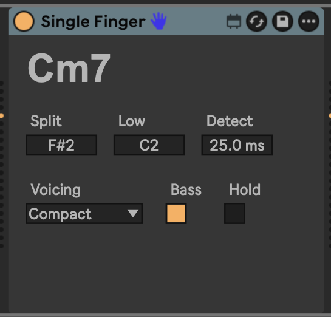

# Single Finger

Yamaha-style **Single Finger** chords as a Max for Live MIDI effect. Play a root key with your left
hand and get a full chord; add a key to its left to change the chord type. It is the fingering mode
from Yamaha's Portatone, PSR, Electone and Clavinova auto-accompaniment, in front of any instrument
in Ableton Live.



## Play

Below the split point (F#2 by default), the highest key you hold is the root:

| Keys | Chord | Example |
|---|---|---|
| root alone | major | C |
| root + any black key to its left | minor | Bb + C |
| root + any white key to its left | seventh | B + C |
| root + a black and a white key to its left | minor seventh | Bb + B + C |

Keys above the split point pass through, so the right hand plays normally.

## Install

1. Download [Single-Finger.zip](https://github.com/ktamas77/single-finger-chords/releases/latest/download/Single-Finger.zip)
   from the [latest release](https://github.com/ktamas77/single-finger-chords/releases/latest) and unzip it.
2. Drag `Single Finger.amxd` onto a MIDI track, in front of the instrument. To keep it, drop it
   into your User Library.

Requires **Ableton Live 12 Suite** (the device uses Max 9's `v8.codebox`).

Also listed on [max4.live](https://max4.live/device/m4l_01M85F7WQTEW02SBKBPNZ9HGMX/single-finger/),
the Max for Live device catalogue.

## Controls

| Control | Default | What it does |
|---|---|---|
| Split | F#2 | Highest key of the chord zone |
| Low | C2 | Bottom of the register the chord sounds in |
| Detect | 25 ms | How long to wait for the other keys of a fingering before sounding the chord |
| Voicing | Compact | Compact keeps every chord inside one octave; Root plays root position |
| Bass | on | Adds the root an octave below |
| Hold | off | Keeps the chord ringing until the next one |

The display shows the chord currently sounding. All controls can be automated and mapped.

**Detect** exists because fingers never land together: without it, Bb + C would sound as a C major
blip followed by C minor. It delays chords only. Set it to 0 if you only ever play one key at a time.

## Status

Tested in Live 12.4.16 on macOS: the device loads, all four chord types and pass-through produce
the right notes, and chords arrive 36 to 46 ms after the key at the default settings (about 6 ms
for pass-through notes). Not yet tested on Windows, or for feel under a real keyboard.
Details and measurements: [docs/single-finger.md](docs/single-finger.md).

Not included: Fingered and Multi Finger modes, other brands' one-finger rules, drums or bass patterns.

## Develop

No dependencies beyond Node.js.

```
node test.js       # chord logic, then builds the device and checks it
node build.js      # writes dist/Single Finger.amxd
node live-test.js  # end-to-end test inside a running Live (needs AbletonOSC)
```

`dist/` is build output and is not committed. Releases are automatic: CI runs `node test.js` on
every push, and a push to `main` that changes the built device publishes the next patch release
with the device attached. Commits that leave the device identical release nothing.

| Path | What |
|---|---|
| `src/core.js` | The chord engine: detection, voicing, note bookkeeping. No Max dependencies. |
| `build.js` | Generates the `.amxd` from code: the patcher, the UI, and `core.js` embedded in a `v8.codebox` |
| `test.js` | Self-check for the engine and the built device |
| `live-test.js` | Plays fingerings through the device in Live and checks the recorded output |
| `docs/single-finger.md` | How Single Finger works, with manual quotes, design decisions and test results |
| `.github/workflows/ci.yml` | Tests on every push; auto-releases from `main` when the device changes |
| `AGENTS.md` | Notes for coding agents working in this repo |

The device is never edited in the Max editor. Change the code and rebuild.

## License

[MIT](LICENSE).

Yamaha, Portatone, Electone and Clavinova are trademarks of Yamaha Corporation. This project is
independent and not affiliated with Yamaha, Ableton or Cycling '74.
